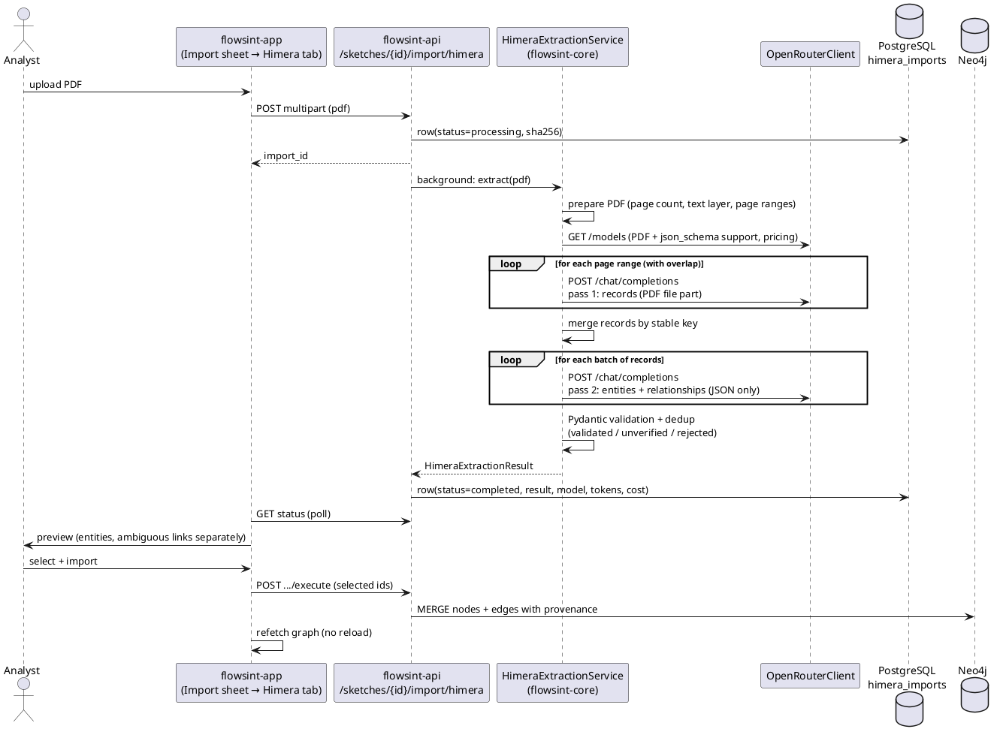

# Himera Search PDF import

This document describes the Himera Search report format, how Flowsint turns a
Himera PDF into graph data with an LLM (via OpenRouter), and which parts of the
existing Flowsint code the import reuses.

All examples below are synthetic. Real Himera reports contain personal data and
must never be committed to the repository or written to logs.

## 1. Report format (reference report: 23 pages, A4, mPDF 8, text layer present)

A Himera PDF is generated by mPDF with an embedded DejaVu font, so the text layer
is present and machine-readable. OCR is only needed for scanned copies.

Top-level structure, in order:

| # | Section (as printed)          | Content                                                                 |
|---|-------------------------------|-------------------------------------------------------------------------|
| 0 | `Отчет № <uuid>`              | Report identifier (UUID), first line of page 1                          |
| 1 | `УСТАНОВОЧНЫЕ ДАННЫЕ`         | Summary of the subject: persons + birth date, passports, phones, СНИЛС, ИНН, possible surnames |
| 2 | `Результаты скоринга`         | Overall score (0.00–1.00) and per-category scores                       |
| 3 | `Метки`                       | Label blocks: name, birth date, region, label text                      |
| 4 | `Доходы`                      | Table: employer, amount, year                                           |
| 5 | `Адреса`                      | Free-form list of address spellings                                     |
| 6 | Detailed records              | Many records, one per dataset hit (see below)                           |
| 7 | Service footer                | "report may be truncated, full TXT at <url>", generator info            |

### Detailed records

Each record starts with a heading line in capitals that names the dataset, its
period and a short dataset code, e.g.

```
КЛИЕНТЫ БАНКА 2023 QV
 Имя                ИВАНОВ ИВАН ИВАНОВИЧ
 Дата рождения      1.2.1990
 Телефон            79990000000
 Емаil              IVANOV@EXAMPLE.RU
```

Observations from the reference report:

* A record is a heading followed by `field  value` pairs. Field names vary per
  dataset (`Телефон`, `Телефоны`, `Дополнительные телефоны`, `Email`, `Емаil`,
  `E-mail`, `ИНН`, `ИИН`, `Номер документа`, `Адрес`, `Банковские карты` ...).
* Headings can wrap onto 2–3 lines (`ПОЛЬЗОВАТЕЛИ РОССИЙСКАЯ / ЭЛЕКТРОННАЯ ШКОЛА
  ... / 2022 12 2G`).
* A record can continue on the next page; the heading is not repeated.
* The same dataset can produce several records in a row (identical heading, the
  values may be identical too). These are separate records and must not be merged
  at extraction time.
* Values are printed "as is" from leaked/aggregated datasets: mixed case, broken
  quoting (`""";";"`), Cyrillic letters inside e-mail addresses (`МАIL.RU` with
  Cyrillic `М` and `А`), phones without `+`, passport numbers with and without
  spaces, many spellings of one address.
* Near the end of the report there are sections marked `(совпадения по фио)` —
  records that matched only by full name. They carry other documents, phones,
  e-mails and no birth date; they must stay separate candidates and are never
  merged into the subject automatically.
* The `Метки` / `Результаты скоринга` sections and records such as
  "criminal record", "black list", "special registry" contain source claims,
  not verified facts.
* The PDF can be truncated compared with the TXT version (the footer says so).
  The import records this as a warning on the result.

## 2. Architecture



### Two LLM passes

1. **Records pass** (PDF in, records out). The model gets one page range of the
   PDF as a `file` content part and returns every record with section, source
   name, original heading, period, start/end page, fields and a verbatim text
   excerpt. No entity typing happens here.
2. **Entities pass** (records JSON in, entities + relationships out). The model
   gets batches of records (no PDF), plus the subject summary, and returns typed
   entities with raw and normalized values, confidence, evidence and
   relationships with a record reference and a status.

A deterministic stage (Pydantic + checksum/format validators) runs after the
LLM and decides what is validated, what stays unverified and what is rejected.
It never invents or corrects facts; it only checks and classifies.

## 3. What is reused from Flowsint

| Need                         | Reused                                                                                 |
|------------------------------|----------------------------------------------------------------------------------------|
| OpenRouter API key           | `VaultService.get_secret(owner, "OPENROUTER_API_KEY")`, env fallback — same lookup as the chat (`ChatService.get_llm_provider`) |
| OpenRouter base URL          | the one in `core/llm/factory.py` (`OPENROUTER_BASE_URL`)                              |
| Authorization                | `get_current_user` + `SketchService.get_by_id` (sketch access check) as in `/import/analyze` |
| Entity types                 | `flowsint_types`: Individual, Phone, Email, Username, SocialAccount, Organization, Location, Document |
| Graph writes                 | `GraphService.batch_create_nodes` (MERGE on `nodeLabel`+`sketch_id` → idempotent) and `batch_create_edges_by_element_id` (relationship properties → provenance) |
| Serialization                | `GraphSerializer.serialize_flowsint_types`                                             |
| UI                           | `import-sheet.tsx` (new tab), `sketch-service.ts`, react-query graph refetch          |

Not reused, and why:

* `LLMProvider` / `OpenAIProvider` only support text chat (`stream`/`complete`).
  The import needs a `file` content part, `plugins` (PDF engine),
  `response_format: json_schema`, `finish_reason` and `usage.cost`. A small
  `OpenRouterClient` on top of `httpx` (already a core dependency) implements
  exactly that and nothing else; it uses the same base URL and key lookup.
* `ImportService.analyze_file` is a line-based TXT/JSON parser; Himera needs the
  LLM. `ImportService.execute_import` cannot attach properties to edges, so the
  Himera importer calls `GraphService` directly.

New Flowsint types (no existing equivalent): `Identifier` (ИНН, СНИЛС, ОГРН,
ИИН …), `Event` (dated facts and source claims), `SourceRecord` (one record of
one dataset in one report).

## 4. Setup

### OpenRouter key

The import uses the same key as the Flowsint chat:

1. **Vault (preferred)** — in the UI open *Settings → Keys* and add a secret named
   `OPENROUTER_API_KEY`. It is looked up for the user who uploaded the PDF.
2. **Environment (fallback)** — `OPENROUTER_API_KEY` in `.env`; it is passed to the
   `api` container by `docker-compose.{dev,prod}.yml`.

### Settings (environment of the `api` container)

| Variable | Default | Meaning |
|---|---|---|
| `HIMERA_MODEL` | `google/gemini-2.5-flash` | OpenRouter model id |
| `HIMERA_PDF_ENGINE` | `auto` | `auto` = `pdf-text` for PDFs with a text layer, `mistral-ocr` for scans; or force `pdf-text` / `mistral-ocr` / `native` |
| `HIMERA_MAX_COST_USD` | `0.50` | hard cap for one document (all calls) |
| `HIMERA_OCR_USD_PER_PAGE` | `0.002` | OCR price used in the pre-call estimate |
| `HIMERA_PAGES_PER_CHUNK` | `4` | page range size for the records pass (`0` = whole PDF in one call) |
| `HIMERA_CHUNK_OVERLAP_PAGES` | `1` | pages shared by neighbouring ranges |
| `HIMERA_RECORDS_PER_BATCH` | `8` | records per call in the entities pass |
| `HIMERA_CONCURRENCY` | `8` | parallel OpenRouter calls; ranges, and then record batches, are sent at once. Each call reserves its worst-case cost in the budget before sending, so parallel calls cannot overshoot `HIMERA_MAX_COST_USD`; the first API error cancels the remaining calls |
| `HIMERA_MAX_OUTPUT_TOKENS` | `16000` | `max_tokens` of every call |
| `HIMERA_TIMEOUT_S` | `180` | HTTP timeout per call |
| `HIMERA_MAX_RETRIES` / `HIMERA_BACKOFF_BASE_S` | `3` / `2` | retries on 408/409/425/429/5xx/timeouts with exponential backoff (honours `Retry-After`) |
| `HIMERA_MAX_REPAIR_ATTEMPTS` | `1` | text-only "fix the JSON" calls after an invalid answer |

### Choosing a model

Before the first call the service reads `GET /api/v1/models` and checks the model:

* **Structured output** — `structured_outputs` in `supported_parameters` →
  `response_format: {type: json_schema, strict: true}`. Otherwise `json_object`
  (or plain prompt) with the schema embedded in the system prompt, and a warning
  in the result. Prefer models with strict structured outputs.
* **PDF input** — with `pdf-text` / `mistral-ocr` OpenRouter parses the PDF
  itself, so any text model works. `native` requires `file` in
  `architecture.input_modalities`, otherwise the import fails before sending.
* **Context / output** — a 23-page report is ~35k prompt tokens; with the
  default chunking each call stays well below 16k output tokens.

Reasonable choices: `google/gemini-2.5-flash` (cheap, file input, structured
outputs), `openai/gpt-4.1-mini`, `anthropic/claude-sonnet-4.5` (more careful
with the subject/namesake distinction, more expensive).

Data policy: the report contains personal data. Configure the OpenRouter
account's data policy (no training / zero data retention providers) before use,
and only upload reports you are allowed to process.

## 5. Processing order

1. **Prepare** (`himera/pdf.py`, pypdf): reject non-PDF/encrypted files, count
   pages, measure the text layer (characters per page, not content), compute the
   SHA-256, plan page ranges.
2. **Records pass** (`extraction.py`): for every range, send the sub-PDF as a
   `file` content part to `POST /api/v1/chat/completions` with the `file-parser`
   plugin (`pdf.engine`) and the `himera_records` schema.
3. **Merge records** (`records.py`): convert range-relative pages to report
   pages and merge copies from overlapping ranges (see §6).
4. **Entities pass**: send record JSON (no PDF) in batches with the subject
   summary; schema `himera_entities`.
5. **Validation** (`validation.py`, `normalizers.py`): see §8.
6. **Store** the `HimeraExtractionResult` in `himera_imports.result` with model,
   tokens and cost.
7. **Preview / import** (`importer.py`): only what the user selected is written
   to Neo4j.

Failure handling:

| Situation | Behaviour |
|---|---|
| `finish_reason = length` (truncated) | the page range / record batch is split in two and retried (up to 3 levels); a single page that still truncates marks the result `complete = false` |
| invalid JSON / schema mismatch | one text-only repair call (no PDF re-send); if it still fails the range is skipped and the result is `complete = false` |
| empty answer | warning; no records at all → `complete = false` |
| 429 / 5xx / timeout | retry with backoff, then the import is `failed` with the error class |
| 4xx (bad key, unsupported request) | no retry, import `failed` |
| budget exceeded | the next call is not sent; the partial result is kept with `complete = false` |

## 6. JSON Schemas

Both schemas are strict (`additionalProperties: false`, all keys required,
nullable via `["string", "null"]`); see `himera/schemas.py`.

`himera_records`:

```json
{
  "report_id": "string|null",
  "truncation_notice": true,
  "records": [{
    "section": "summary|scoring|labels|income|addresses|dataset_record|service",
    "source_name": "string|null", "source_heading": "string", "source_period": "string|null",
    "page_start": 1, "page_end": 2, "ordinal_on_start_page": 1,
    "starts_before_range": false, "continues_after_range": false,
    "fields": [{"name": "Телефон", "value": "79990000000"}],
    "name_match_only": false
  }]
}
```

`himera_entities`:

```json
{
  "entities": [{
    "entity_id": "e1",
    "type": "Individual|Phone|Email|Username|SocialAccount|Organization|Address|Document|Identifier|Event",
    "raw_value": "string", "normalized_value": "string|null",
    "record_id": "p02-01", "page": 2, "evidence": "string", "confidence": 0.9,
    "subject_link": "subject|other_person|unknown|not_applicable",
    "role": "string|null", "attributes": [{"name": "birth_date", "value": "3.4.1985"}]
  }],
  "relationships": [{
    "type": "HAS_PHONE", "source_entity_id": "e1", "target_entity_id": "e2",
    "record_id": "p02-01", "evidence": "string", "confidence": 0.9,
    "status": "confirmed|candidate|source_claim"
  }]
}
```

## 7. Multi-page records and page ranges

* Record id = `p<page_start>-<ordinal>`: the record's position among records
  that **start** on that page. It is stable across ranges and different for two
  identical records in a row, so real duplicates are kept.
* Ranges overlap by `HIMERA_CHUNK_OVERLAP_PAGES`. A record seen in two ranges
  has the same `(page_start, ordinal, heading)` key; the copy whose end was
  seen (`continues_after_range = false`) or with more fields wins.
* A record cut by the end of a range is `continues_after_range`; the next range
  returns its tail as `starts_before_range` with heading `<continuation>`. The
  tail's fields are appended to the open record (pairs already present are not
  duplicated) and `page_end` is extended.
* A record still open at the end gets a warning ("may continue beyond page N").
* The footer's "report may be truncated" → `truncation_notice` + warning.

## 8. Validation, identity and relationship rules

Deterministic checks after the LLM (they classify, they never invent values):

| Check | Result |
|---|---|
| placeholder / empty value (`-`, `нет`, `***`) | rejected |
| `record_id` unknown | rejected |
| raw value not present in the cited record text | **unverified** |
| e-mail grammar; Cyrillic look-alike letters (`МАIL.RU`) | look-alikes are mapped to Latin in `normalized_value`, raw kept, entity **unverified** |
| phone → E.164 (`phonenumbers`, RU default, `8…`/`7…`/10-digit forms) | invalid/only-possible → **unverified** |
| ИНН (10/12), СНИЛС, ОГРН/ОГРНИП, ИИН (KZ), card (Luhn), account (20 digits) checksums | failed → **unverified** |
| dates (`d.m.yyyy`, ISO, `yyyy`, `…Г`) → ISO | invalid → issue, raw kept |
| page outside the record's pages | issue, page clamped |
| LLM normalisation differs from the format check | issue, the check's value is used |

Deduplication (`ExtractedEntity.mentions` keeps every record/page/evidence):

* validated entities merge by `(type, normalized_value)`;
* unverified entities never merge with anything;
* Individuals: everything the model marked `subject` (and not in a name-only
  record) becomes one subject node; others merge only on equal name **and**
  birth date; without a birth date each record gives its own candidate.

Relationships:

* both ends must exist **and** be mentioned in the cited record, otherwise the
  link is rejected ("not mentioned in the cited record") — co-occurrence in the
  report is never enough;
* links in a name-only record, to a person with unknown identity or to an
  unverified entity are downgraded to `candidate`;
* links to `Event` (labels, scores, registries, criminal/black-list entries)
  are always `source_claim`: a statement of the source, not a fact;
* `confirmed` → `relationships`; `candidate` / `source_claim` →
  `ambiguous_relationships` (shown separately, not imported by default);
* relationship type is sanitised to `[A-Z0-9_]`.

## 9. Graph model

| Himera type | Flowsint type | Node label |
|---|---|---|
| Individual | `Individual` | subject: `NAME (YYYY-MM-DD)`; others: `… [кандидат …]` |
| Phone | `Phone` | E.164 |
| Email | `Email` | address |
| Username | `Username` | value |
| SocialAccount | `SocialAccount` | `handle@platform` |
| Organization | `Organization` (+ `inn`, `ogrn`) | name |
| Address | `Location` | normalised address |
| Document | `Document` | `doc_type number` |
| Identifier | `Identifier` (new) | `SCHEME value` |
| Event | `Event` (new) | title |
| record | `SourceRecord` (new) | `heading (p. N) #record [report]` |

Unverified values are labelled `raw (не подтверждено)` so they never MERGE with
validated nodes.

Provenance on every node: `source=himera`, `himera_report`, `himera_records`,
`himera_pages`, `himera_raw_value`, `himera_verification`, `himera_confidence`,
`himera_subject_link`. On every relationship: `himera_report`, `record_id`,
`page_start`, `page_end`, `evidence`, `confidence`, `status`,
`is_source_claim`. `SourceRecord -[:MENTIONS]-> entity` edges link each value to
the record and page it was read from.

Re-import: nodes MERGE on `(type, nodeLabel, sketch)` and edges on their full
property set, and a second upload of the same PDF reuses the stored analysis
(same SHA-256 in the same sketch), so nothing is duplicated and nothing is paid
twice. Use `force=true` to re-analyse.

## 10. Using the import in the UI

1. Open a sketch → *Import* → **Himera Search PDF**.
2. Choose the PDF. The analysis runs in the background (progress: spinner; it
   can take a few minutes; the page polls every 3 s).
3. Preview tabs: **Entities** (validated, selected by default), **Unverified**
   (not selected), **Relationships** (confirmed, selected), **Ambiguous
   relationships** (candidates and source claims, not selected), **Records**
   (all records with pages). Header: records/entities count, model, engine,
   tokens, cost, warnings; a red banner if the analysis is incomplete.
4. Optionally untick *Add source record nodes*.
5. **Import** — the graph refreshes without reloading the page.
6. Select an imported Email or Username node → *Enrich* to run
   `email_to_username`, `email_to_gravatar`, `email_to_domain`,
   `username_to_socials_maigret`, `username_to_socials_sherlock`.

API (authorised with the usual bearer token; upload/import need *update*
rights on the investigation, the preview needs *read*):

| Method | Path |
|---|---|
| `POST` | `/api/sketches/{sketch_id}/import/himera` (multipart `file`, optional `force`) |
| `GET` | `/api/sketches/{sketch_id}/import/himera/{import_id}` |
| `POST` | `/api/sketches/{sketch_id}/import/himera/{import_id}/execute` (`entity_ids`, `relationship_ids`, `include_source_records`) |

## 11. Cost and limits

* Cost per call comes from OpenRouter `usage.cost`; when absent it is computed
  from the model's per-token price. The sum is stored per import and shown in
  the preview.
* Before each call the service estimates `prompt tokens × price + max_tokens ×
  completion price (+ OCR pages)` and refuses the call if the document budget
  would be exceeded.
* PDF size limit 20 MB. Encrypted PDFs are rejected.
* The LLM can miss or misread values; the deterministic checks catch format
  errors and values that are not in the cited record, but not a wrong but
  well-formed value copied from another line. Always review the preview.
* The PDF can be shorter than Himera's TXT version.

## 12. Tests and quality measurement

* `flowsint-core/tests/himera/` — unit and pipeline tests with a scripted
  OpenRouter (no network, no cost): client (retries, errors, budget), PDF
  preparation, records pass (chunks, truncation, repair, empty), entities pass,
  validation, importer (provenance, re-import), enricher compatibility, metrics.
* `flowsint-api/tests/test_himera_import.py` — upload → preview → import
  through the API (auth, viewer forbidden, cached re-upload, missing key).
* Synthetic fixtures (fictional data) in `tests/himera/fixtures/`:
  `synthetic_report.pdf` (4 pages: two records on one page, identical
  duplicate records, a record spanning pages 2–3, a namesake section, an e-mail
  with Cyrillic look-alikes, several phones and social profiles),
  `scanned_report.pdf`, expected answers and the gold file
  `expected_synthetic.json`. Regenerate with `make_fixtures.py`.
* Metrics (`himera/metrics.py`): record precision/recall, entity
  precision/recall (Event excluded), precision/recall of confirmed subject
  relationships, wrong links of the subject to namesake values, unverified and
  ambiguous shares, cost/tokens.
* Live test (costs money, sends the fictional PDF):

  ```bash
  HIMERA_LIVE_TEST=1 OPENROUTER_API_KEY=... uv run python -m pytest \
      flowsint-core/tests/himera/test_metrics_and_e2e.py -k live -s
  ```

* A real report (personal data!) only with explicit operator consent:

  ```bash
  HIMERA_ALLOW_SEND=1 OPENROUTER_API_KEY=... uv run python -m flowsint_core.himera \
      report.pdf --out /safe/place/result.json
  ```

  Only counts and metrics are printed; the full result goes to `--out`, which
  must stay out of the repository.

## 13. Measured results (2026-11-14, `google/gemini-2.5-flash`, engine `pdf-text`)

Synthetic report (4 pages, fictional data, gold file), sequential version:
record precision/recall 1.0/1.0, entity precision/recall 0.70/0.84 (mostly
normalisation differences: `Ё`→`Е`, addresses not unified, extra organisation
ИНН/ОГРН identifiers missing from the gold), confirmed subject relationships
precision/recall 0.92/1.0, 0 subject links to namesake values, 1 subject node,
unverified share 7 % (the look-alike e-mail), cost $0.034.

Reference Himera report (23 pages, real data, counts only):

| Version | Time | Cost | Records | Entities (+unverified) | Confirmed / ambiguous links |
|---|---|---|---|---|---|
| sequential, 6-page ranges | ~7 min | $0.243 | 63 (2 duplicates on overlap pages) | 86 (+3) | 131 / 43 |
| parallel, 4-page ranges (final) | 59 s | $0.237 | 61 | 100 (+2) | 118 / 59 |

In all runs: 23/23 pages covered, one subject node, namesake records kept as
separate candidates (every link from them is `candidate`), labels/scores as
`source_claim`, the truncation footer detected.

Known limits seen on the real report: in the garbled name-match section at the
end (broken CSV quoting inside values) the model sometimes takes a field line
(`Карта тройка …`, `Огранизация …`) for a record heading, so the section is
split into more records than printed; their links stay `candidate` because the
person identity is unknown. A record cut by a range end that the next range
does not report again keeps a "may continue" warning.
