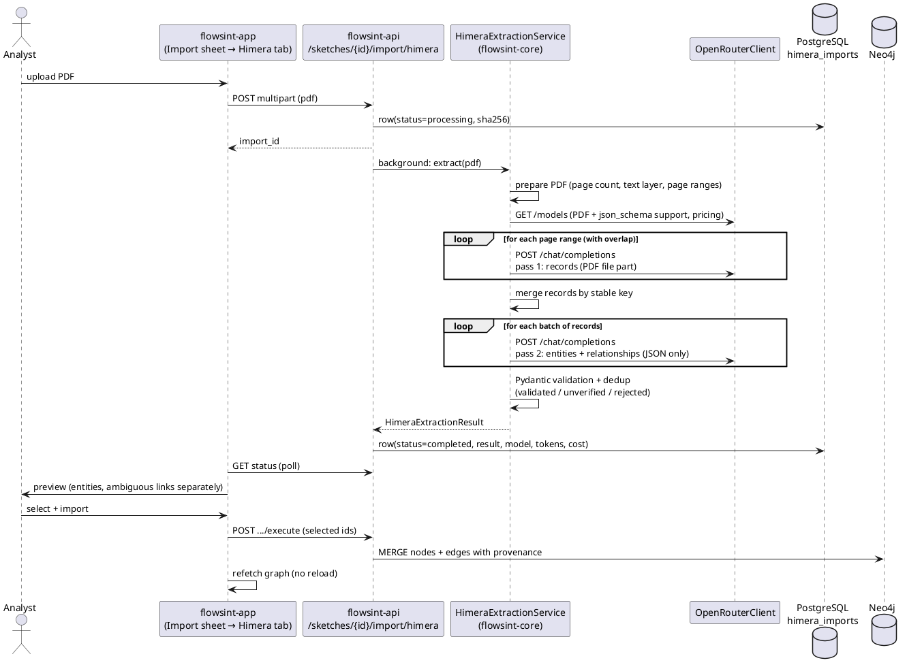

# Himera Search PDF import

This document describes the Himera Search report format, how Flowsint turns a
Himera PDF into graph data with an LLM (via OpenRouter), and which parts of the
existing Flowsint code the import reuses.

All examples below are synthetic. Real Himera reports contain personal data and
must never be committed to the repository or written to logs.

## 1. Report format (reference report: 23 pages, A4, mPDF 8, text layer present)

A Himera PDF is generated by mPDF with an embedded DejaVu font, so the text layer
is present and machine-readable. OCR is only needed for scanned copies.

Top-level structure, in order:

| # | Section (as printed)          | Content                                                                 |
|---|-------------------------------|-------------------------------------------------------------------------|
| 0 | `Отчет № <uuid>`              | Report identifier (UUID), first line of page 1                          |
| 1 | `УСТАНОВОЧНЫЕ ДАННЫЕ`         | Summary of the subject: persons + birth date, passports, phones, СНИЛС, ИНН, possible surnames |
| 2 | `Результаты скоринга`         | Overall score (0.00–1.00) and per-category scores                       |
| 3 | `Метки`                       | Label blocks: name, birth date, region, label text                      |
| 4 | `Доходы`                      | Table: employer, amount, year                                           |
| 5 | `Адреса`                      | Free-form list of address spellings                                     |
| 6 | Detailed records              | Many records, one per dataset hit (see below)                           |
| 7 | Service footer                | "report may be truncated, full TXT at <url>", generator info            |

### Detailed records

Each record starts with a heading line in capitals that names the dataset, its
period and a short dataset code, e.g.

```
КЛИЕНТЫ БАНКА 2023 QV
 Имя                ИВАНОВ ИВАН ИВАНОВИЧ
 Дата рождения      1.2.1990
 Телефон            79990000000
 Емаil              IVANOV@EXAMPLE.RU
```

Observations from the reference report:

* A record is a heading followed by `field  value` pairs. Field names vary per
  dataset (`Телефон`, `Телефоны`, `Дополнительные телефоны`, `Email`, `Емаil`,
  `E-mail`, `ИНН`, `ИИН`, `Номер документа`, `Адрес`, `Банковские карты` ...).
* Headings can wrap onto 2–3 lines (`ПОЛЬЗОВАТЕЛИ РОССИЙСКАЯ / ЭЛЕКТРОННАЯ ШКОЛА
  ... / 2022 12 2G`).
* A record can continue on the next page; the heading is not repeated.
* The same dataset can produce several records in a row (identical heading, the
  values may be identical too). These are separate records and must not be merged
  at extraction time.
* Values are printed "as is" from leaked/aggregated datasets: mixed case, broken
  quoting (`""";";"`), Cyrillic letters inside e-mail addresses (`МАIL.RU` with
  Cyrillic `М` and `А`), phones without `+`, passport numbers with and without
  spaces, many spellings of one address.
* Near the end of the report there are sections marked `(совпадения по фио)` —
  records that matched only by full name. They carry other documents, phones,
  e-mails and no birth date; they must stay separate candidates and are never
  merged into the subject automatically.
* The `Метки` / `Результаты скоринга` sections and records such as
  "criminal record", "black list", "special registry" contain source claims,
  not verified facts.
* The PDF can be truncated compared with the TXT version (the footer says so).
  The import records this as a warning on the result.

## 2. Architecture



### Two LLM passes

1. **Records pass** (PDF in, records out). The model gets one page range of the
   PDF as a `file` content part and returns every record with section, source
   name, original heading, period, start/end page, fields and a verbatim text
   excerpt. No entity typing happens here.
2. **Entities pass** (records JSON in, entities + relationships out). The model
   gets batches of records (no PDF), plus the subject summary, and returns typed
   entities with raw and normalized values, confidence, evidence and
   relationships with a record reference and a status.

A deterministic stage (Pydantic + checksum/format validators) runs after the
LLM and decides what is validated, what stays unverified and what is rejected.
It never invents or corrects facts; it only checks and classifies.

## 3. What is reused from Flowsint

| Need                         | Reused                                                                                 |
|------------------------------|----------------------------------------------------------------------------------------|
| OpenRouter API key           | `VaultService.get_secret(owner, "OPENROUTER_API_KEY")`, env fallback — same lookup as the chat (`ChatService.get_llm_provider`) |
| OpenRouter base URL          | the one in `core/llm/factory.py` (`OPENROUTER_BASE_URL`)                              |
| Authorization                | `get_current_user` + `SketchService.get_by_id` (sketch access check) as in `/import/analyze` |
| Entity types                 | `flowsint_types`: Individual, Phone, Email, Username, SocialAccount, Organization, Location, Document |
| Graph writes                 | `GraphService.batch_create_nodes` (MERGE on `nodeLabel`+`sketch_id` → idempotent) and `batch_create_edges_by_element_id` (relationship properties → provenance) |
| Serialization                | `GraphSerializer.serialize_flowsint_types`                                             |
| UI                           | `import-sheet.tsx` (new tab), `sketch-service.ts`, react-query graph refetch          |

Not reused, and why:

* `LLMProvider` / `OpenAIProvider` only support text chat (`stream`/`complete`).
  The import needs a `file` content part, `plugins` (PDF engine),
  `response_format: json_schema`, `finish_reason` and `usage.cost`. A small
  `OpenRouterClient` on top of `httpx` (already a core dependency) implements
  exactly that and nothing else; it uses the same base URL and key lookup.
* `ImportService.analyze_file` is a line-based TXT/JSON parser; Himera needs the
  LLM. `ImportService.execute_import` cannot attach properties to edges, so the
  Himera importer calls `GraphService` directly.

New Flowsint types (no existing equivalent): `Identifier` (ИНН, СНИЛС, ОГРН,
ИИН …), `Event` (dated facts and source claims), `SourceRecord` (one record of
one dataset in one report).
